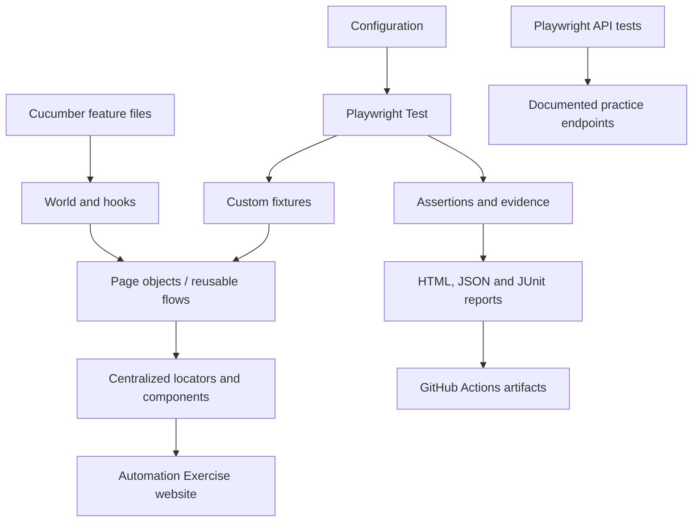

# Automation Exercise — Playwright JavaScript Framework

A maintainable end-to-end automation framework for the public [Automation Exercise](https://www.automationexercise.com/) practice site. The project is designed around Playwright Test, page objects, centralized locator factories, custom fixtures, Cucumber.js BDD, API checks grounded in published documentation, reports, and GitHub Actions.

> **Delivery status:** repository bootstrap is in progress. The README describes the intended framework scope; do not treat listed test coverage as execution evidence. Tests must be installed and run before any result can be called passing.

## Quick start

- Node.js 20 or newer.
- Install dependencies: `npm ci`.
- Install a browser: `npx playwright install --with-deps chromium`.
- Copy `.env.example` to `.env` to override defaults.
- Run the smoke suite: `npm run test:smoke`.
- Run public API checks: `npm run test:api`.
- Run BDD scenarios: `npm run test:bdd`.
- Open a generated HTML report: `npm run report` (after a Playwright run).

## Architecture

## Major layers

- `config/`: environment, timeout and browser settings.
- `fixtures/`: composition of page objects over Playwright's isolated page fixture.
- `pages/`, `locators/`, `components/`: behavior, selectors and reusable UI components kept separate.
- `flows/`: multi-page journeys that orchestrate page objects.
- `tests/`: UI smoke/regression and documented API scenarios.
- `bdd/`: Gherkin, step definitions, Cucumber World and hooks; executed independently from Playwright Test.
- `data/`, `utils/`: data factories and focused helpers.
- `docs/`: architecture, installation, debugging, reporting, CI and learning resources.
- `.github/workflows/`: workflow definitions for validation and regression.

## Useful commands

| Command | Purpose |
|---|---|
| `npm test` | Full Playwright suite |
| `npm run test:smoke` | Smoke suite |
| `npm run test:regression` | Broader regression suite |
| `npm run test:headed` | Headed browser execution |
| `npm run test:debug` | Inspector debugging |
| `npm run test:ui` | Playwright UI mode |
| `npm run test:chromium` | Chromium project |
| `npm run test:firefox` | Firefox project |
| `npm run test:webkit` | WebKit project |
| `npm run test:api` | Publicly documented API checks |
| `npm run test:bdd` | Cucumber suite |
| `npm run test:bdd:smoke` | Smoke-tagged BDD scenarios |
| `npm run lint` | ESLint |
| `npm run format:check` | Prettier check |
| `npm run report` | Open generated HTML report |
| `npm run clean:reports` | Remove generated artifacts only |
| `npm run validate:config` | Validate framework configuration |

## Learning path

Begin at `tests/smoke/home-page.spec.js`, then read `fixtures/README.md`, `docs/fixtures-and-locators.md`, and `docs/page-object-model.md`. Compare the same behavior in `bdd/features/`, learn to inspect the trace using `docs/debugging.md`, then explore `docs/reporting.md` and `docs/ci-cd.md`.

## Responsible public-site testing

Automation Exercise is shared practice infrastructure. Use bounded runs, unique emails for any account-creation tests, low concurrency for stateful workflows, and dummy checkout data only. Do not commit credentials, `.env`, storage state, or generated artifacts containing sensitive data.

## API basis

API scenarios must follow the site's [published API list](https://www.automationexercise.com/api_list), rather than guessed contracts. The public site can change; inspect the actual run report and response payloads before classifying a failure.

## CI/CD

Workflows are intended to install dependencies, validate/lint the project, run suites, and upload reports as artifacts even on failure. A workflow should be described as passing only after GitHub Actions shows a successful completed run. A green run applies only to the scenarios and environment used by that execution.
