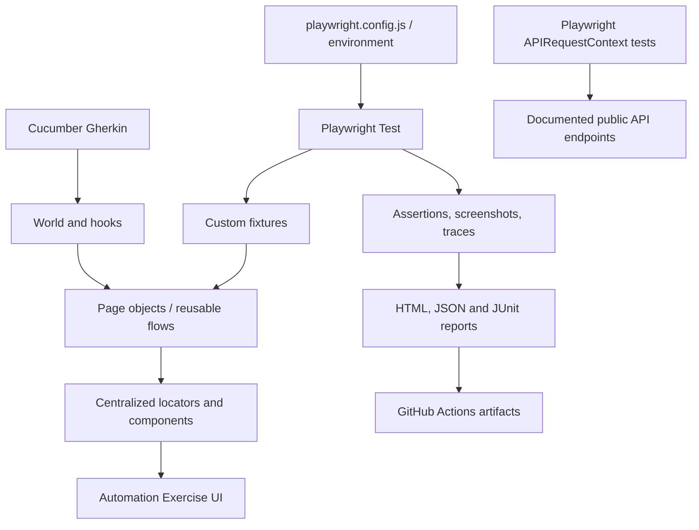

# Automation Exercise — Playwright JavaScript Framework

A maintainable end-to-end automation framework for the public [Automation Exercise](https://www.automationexercise.com/) practice site. It combines Playwright Test, page objects, centralized locator factories, custom fixtures, Cucumber.js BDD, documented API tests, reporting, and GitHub Actions.

> **Status:** framework baseline is being established. Test coverage is not a claim that every public-site scenario has passed; verify with the commands below and inspect CI artifacts for the actual result.

## Quick start

- Node.js 20 or newer
- Install dependencies: `npm ci`
- Install browser: `npx playwright install --with-deps chromium`
- Copy `.env.example` to `.env` if you need to override defaults.
- Run the small smoke suite: `npm run test:smoke`
- Run API checks: `npm run test:api`
- Run BDD: `npm run test:bdd`
- Open the HTML report: `npm run report`

## Architecture

## Project structure

- `config/` — environment and framework settings
- `fixtures/` — composable Playwright page-object fixtures
- `pages/`, `locators/`, `components/` — separation of UI behavior and selectors
- `flows/` — reusable multi-page user journeys
- `tests/` — smoke, navigation, products, cart, forms, API and regression checks
- `bdd/` — Cucumber features, step definitions, World and hooks
- `data/`, `utils/` — generated test data and utilities
- `docs/` — architecture, setup, troubleshooting, CI and learning roadmap
- `.github/workflows/` — PR smoke validation and scheduled/regression workflow definitions

## Core commands

| Command | Purpose |
|---|---|
| `npm test` | Full Playwright suite |
| `npm run test:smoke` | Fast smoke suite |
| `npm run test:regression` | Broader regression suite |
| `npm run test:headed` | Headed browser run |
| `npm run test:debug` | Playwright Inspector debug mode |
| `npm run test:ui` | Playwright UI mode |
| `npm run test:chromium` | Chromium project |
| `npm run test:firefox` | Firefox project |
| `npm run test:webkit` | WebKit project |
| `npm run test:api` | Public API checks based on the site's published API list |
| `npm run test:bdd` | Cucumber scenarios |
| `npm run test:bdd:smoke` | Smoke-tagged BDD scenarios |
| `npm run lint` | ESLint |
| `npm run format` | Prettier formatting |
| `npm run report` | Open Playwright HTML report |
| `npm run clean:reports` | Remove generated reports and test artifacts |
| `npm run validate:config` | Validate framework environment/configuration |

## Learning path

1. Start with `tests/smoke/home-page.spec.js`.
2. Follow `fixtures/README.md` to understand fixture lifecycle.
3. Read `docs/fixtures-and-locators.md` and inspect `locators/`.
4. Read `docs/page-object-model.md` and compare a test with its page object.
5. Explore `flows/README.md` for multi-page flows.
6. Try the equivalent user story under `bdd/features/`.
7. Read `docs/reporting.md` to use traces and test reports.
8. Read `docs/ci-cd.md` before enabling workflows on your repository.

## Responsible test data

The site is shared public practice infrastructure. Keep runs bounded, use generated unique email addresses where account creation is tested, avoid high-volume parallel account creation, use dummy checkout data only, and never commit `.env`, credentials, storage state, or generated report artifacts containing sensitive data.

## API basis

API coverage should follow the published [Automation Exercise API list](https://www.automationexercise.com/api_list). Do not infer undocumented contracts. Public demo behavior may change; inspect the CI run and report before treating results as current.

## CI

GitHub Actions runs install, lint, and smoke validation on pull requests and provides a scheduled/manual regression path. Reports and failure evidence are uploaded as workflow artifacts. A green workflow is evidence only for the scenarios executed in that run, not proof that every possible user journey works.

See `docs/installation.md`, `docs/test-strategy.md`, `docs/debugging.md`, `docs/reporting.md`, and `docs/troubleshooting.md` for details.
