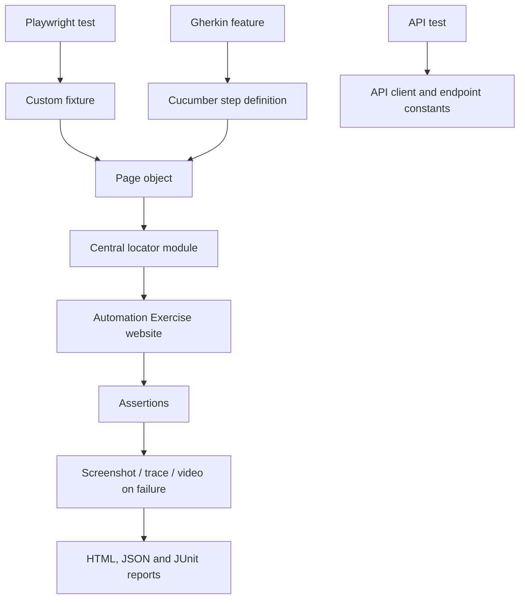

# Automation Exercise — Industry-Oriented Playwright Framework

A JavaScript end-to-end (E2E) automation framework for the public [Automation Exercise](https://www.automationexercise.com/) practice application. It is both a working automation project and a guided learning repository: start with one test, follow the fixture and page-object layers, then build complete customer journeys.

> **Scope and honest status:** this repository contains UI, API and Cucumber/BDD layers. E2E means a journey across real application pages and user-visible behavior; it does not mean every possible business scenario has been implemented or that every browser/suite has passed. See the current [GitHub Actions runs](https://github.com/SanFlash/automationExercise/actions) for evidence. The public site is shared infrastructure and may change.

## Start here: your first 15 minutes

**Prerequisites:** Node.js 20+, npm, Git, and a terminal.

```bash
git clone https://github.com/SanFlash/automationExercise.git
cd automationExercise
npm install
npx playwright install
npm run validate:config
npm run test:smoke
```

To see the browser while tests run: `npm run test:headed`. To debug one test: `npx playwright test tests/smoke/home-page.spec.js --debug`. After a run, open the report with `npm run report`.

Create a local `.env` from `.env.example` only if you need to override configuration. Never commit `.env`, credentials, authenticated browser state, or sensitive test artifacts.

## Learning curriculum

Treat each module as a lesson: read the concept, open the linked code, run the example, change one thing, then run it again.

| Module | Learn | Start with |
|---|---|---|
| 1. Test design | Arrange–Act–Assert, clear test names, meaningful assertions | `tests/smoke/home-page.spec.js` |
| 2. Playwright basics | `page`, navigation, locators, assertions, auto-waiting | `tests/navigation/navigation.spec.js` |
| 3. Locator strategy | Role/text/CSS selectors, centralizing brittle selectors | `locators/` and `docs/fixtures-and-locators.md` |
| 4. Page Object Model | Page objects encapsulate behavior; tests describe intent | `pages/` and `docs/page-object-model.md` |
| 5. Fixtures & isolation | Reusable setup, per-test browser contexts, dependency injection | `fixtures/base.fixture.js` |
| 6. Test data | Unique generated data, invalid data, environment variables | `data/` and `utils/test-data.factory.js` |
| 7. E2E journeys | Verify a user journey across catalogue, cart and checkout boundaries | `tests/e2e/` |
| 8. API testing | HTTP requests, status and response contract assertions | `tests/api/` and `api/` |
| 9. BDD with Gherkin | Feature files, Given/When/Then, step definitions, World/hooks | `bdd/features/` |
| 10. Evidence & debugging | Traces, screenshots, videos, HTML/JSON/JUnit reports | `docs/debugging.md`, `docs/reporting.md` |
| 11. Quality gates | Lint, formatting, config validation, CI artifacts | `.github/workflows/` and `docs/ci-cd.md` |
| 12. Maintainability | Small methods, explicit assertions, stable selectors, controlled retries | `docs/architecture.md` |

Recommended sequence: complete modules 1–6 first. Then run E2E and API tests independently, compare the BDD implementation, and finally inspect a deliberately failing test's trace.

## How a test reaches the browser



- **Tests** express scenarios and assertions. Keep them readable and business-focused.
- **Fixtures** create page objects around Playwright's isolated `page`; avoid global shared mutable browser state.
- **Page objects** offer actions and meaningful locators, not hidden assertions for every behavior.
- **Locators** are centralized to make UI changes easier to maintain. Prefer accessible roles/labels when practical; CSS is appropriate when the app lacks semantic hooks.
- **Components** represent repeated UI such as navigation and product cards.
- **Data factories** generate unique, disposable test data. Do not rely on a single account being available to every parallel worker.
- **BDD** is a separate Cucumber execution path; it does not automatically share Playwright Test fixtures or reporters.
- **CI** is a repeatable execution environment, not proof that scenarios outside the run are covered.

## Test suites and commands

| Command | Purpose |
|---|---|
| `npm test` | Run all Playwright `.spec.js` tests discovered under `tests/` |
| `npm run test:smoke` | Fast availability/navigation confidence checks |
| `npm run test:e2e` | Cross-page customer journeys |
| `npm run test:regression` | Broader UI regression suite |
| `npm run test:api` | HTTP/API scenarios |
| `npm run test:bdd` | All configured Cucumber scenarios |
| `npm run test:bdd:smoke` | Smoke-tagged Cucumber scenarios |
| `npm run test:headed` | Run with a visible browser |
| `npm run test:debug` | Playwright Inspector/debug mode |
| `npm run test:ui` | Playwright UI runner |
| `npm run test:chromium` / `test:firefox` / `test:webkit` | Browser-specific execution |
| `npm run lint` | ESLint static checks |
| `npm run format:check` | Verify Prettier formatting |
| `npm run validate:config` | Validate framework configuration |
| `npm run report` | Open the generated HTML report |
| `npm run clean:reports` | Clean generated report artifacts |

Run a single file or test title without editing configuration:

```bash
npx playwright test tests/e2e/shopping-journey.spec.js --project=chromium
npx playwright test -g "adds a product"
npx playwright test --list
```

## Environment and browser configuration

- Default target: public Automation Exercise website; see `config/environment.js` and `config/framework.config.js`.
- Browser projects are declared in `playwright.config.js`. CI should install the browser binaries it actually executes.
- Timeouts, retries, workers and artifacts are centralized in configuration. Retries are for diagnosis, not a way to hide flaky tests.
- Use low concurrency for stateful public-site scenarios. Tests that create accounts or place orders should use unique data and clean up where supported.

## Reports and failure triage

Each Playwright run can produce:
- HTML report under `reports/html`
- JSON results at `reports/results.json`
- JUnit XML at `reports/junit.xml`
- Screenshots, videos and traces under `test-results/` according to the Playwright configuration

Workflow artifacts are available from the corresponding Actions run. When a test fails: reproduce it alone, inspect the first failing assertion, open the trace, verify the selector and page state, then fix the cause. Avoid fixed sleeps; use Playwright's locator auto-waiting and web-first assertions.

## Responsible test data and public-site boundaries

This is a shared training website. Use synthetic data, dummy payment details only, restrained concurrency, and non-destructive tests. Do not run load tests or security scans against the public site without explicit permission from its owner. Do not attempt to bypass CAPTCHA or other access controls. A missing configured account should be treated as a test prerequisite, not replaced with a real personal account.

## Repository map

- `config/` — environment, browser and framework configuration
- `fixtures/` — custom Playwright fixtures
- `pages/`, `locators/`, `components/` — page-object and UI abstraction layers
- `tests/smoke/`, `tests/navigation/`, `tests/authentication/`, `tests/products/`, `tests/cart/`, `tests/contact/`, `tests/subscription/`, `tests/e2e/`, `tests/api/` — scenario suites
- `bdd/features/`, `bdd/step-definitions/`, `bdd/support/` — Cucumber BDD
- `api/` — API client and endpoint constants
- `data/`, `utils/` — reusable data and helpers
- `docs/` — focused learning modules and operating guidance
- `.github/workflows/` — pull-request, BDD and scheduled workflow definitions

## Contribution checklist

Before opening a pull request:
1. Add a stable, descriptive test ID and assert the user-visible outcome.
2. Put reusable selectors in the matching locator module and multi-step behavior in a page object/flow.
3. Keep test data unique and secrets out of source control.
4. Run config validation, lint, formatting, and the relevant test suite locally.
5. Check report artifacts and ensure tests do not depend on execution order.
6. Update the relevant learning document when adding a framework pattern.

## Further reading

- [Architecture](docs/architecture.md)
- [Installation](docs/installation.md)
- [Fixtures and locators](docs/fixtures-and-locators.md)
- [Page Object Model](docs/page-object-model.md)
- [Debugging and traces](docs/debugging.md)
- [Reporting](docs/reporting.md)
- [CI/CD](docs/ci-cd.md)
- [Test strategy](docs/test-strategy.md)
- [Troubleshooting](docs/troubleshooting.md)
- [Learning roadmap](docs/learning-roadmap.md)
- [BDD guide](bdd/README.md)
- [API guide](api/README.md)
