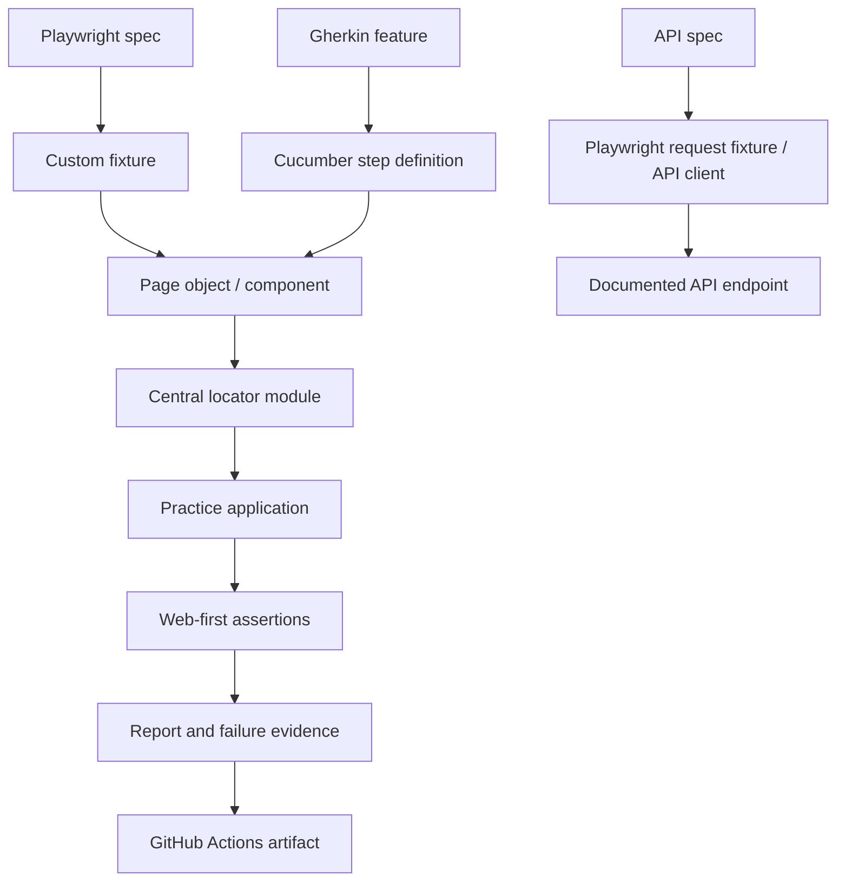
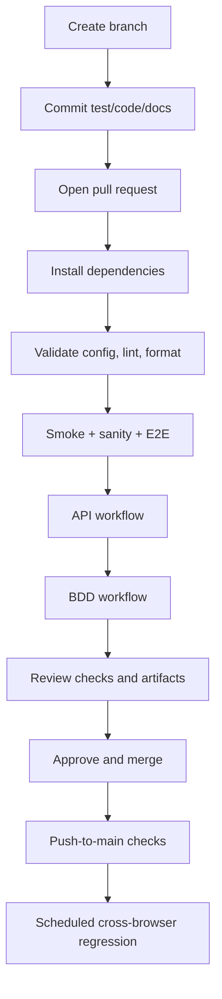

# Automation Exercise — Complete Playwright Automation Engineering Guide

> **Created and maintained by Satyendra Kumar Namdeo**  
> Original project author: **Satyendra Kumar Namdeo** · GitHub: [@SanFlash](https://github.com/SanFlash)  
> Copyright © 2026 Satyendra Kumar Namdeo. All rights reserved unless otherwise stated. See [PROJECT-ATTRIBUTION.md](PROJECT-ATTRIBUTION.md) for attribution and usage terms.

> **Purpose:** this repository is both a JavaScript automation framework and a structured training course. It teaches how a maintainable browser-automation project is designed, implemented, executed, debugged, reported, and delivered through CI/CD. Read the guide in order, open the referenced source files, run the examples, and complete the exercises.

**Target application:** [Automation Exercise](https://www.automationexercise.com/) — a public e-commerce practice site.  
**Stack:** JavaScript ES modules, Playwright Test, Cucumber.js/Gherkin, ESLint, Prettier, Faker, GitHub Actions.  
**Repository:** [SanFlash/automationExercise](https://github.com/SanFlash/automationExercise).

## Project status and honest coverage statement

This is an actively developed training framework. It includes smoke, sanity, UI regression, API contract, E2E, Cucumber BDD, multi-browser configuration, report/evidence capture, and CI workflow definitions. The automated tests exercise only the scenarios that exist in the repository; a page object or README entry alone is not proof that a business flow has been tested. Check [GitHub Actions](https://github.com/SanFlash/automationExercise/actions) for the latest result for a particular commit.

The public practice site can change or become temporarily unavailable. A failure can therefore indicate an application defect, a changed selector, an unavailable environment, or a test-data/prerequisite issue. Investigate the report before classifying it.

## Table of contents

- [1. Learning outcomes and course route](#1-learning-outcomes-and-course-route)
- [2. Prerequisites and setup](#2-prerequisites-and-setup)
- [3. Running the framework](#3-running-the-framework)
- [4. Test types and when to use each](#4-test-types-and-when-to-use-each)
- [5. Architecture and execution lifecycle](#5-architecture-and-execution-lifecycle)
- [6. Folder-by-folder repository guide](#6-folder-by-folder-repository-guide)
- [7. Playwright fundamentals](#7-playwright-fundamentals)
- [8. Locator engineering](#8-locator-engineering)
- [9. Page Object Model and components](#9-page-object-model-and-components)
- [10. Fixtures, isolation, and lifecycle](#10-fixtures-isolation-and-lifecycle)
- [11. Test data and environment configuration](#11-test-data-and-environment-configuration)
- [12. Writing a high-quality UI test](#12-writing-a-high-quality-ui-test)
- [13. End-to-end journeys](#13-end-to-end-journeys)
- [14. API testing](#14-api-testing)
- [15. BDD with Cucumber](#15-bdd-with-cucumber)
- [16. Cross-browser and mobile emulation](#16-cross-browser-and-mobile-emulation)
- [17. Reports, screenshots, video, and traces](#17-reports-screenshots-video-and-traces)
- [18. CI/CD: from pull request to scheduled regression](#18-cicd-from-pull-request-to-scheduled-regression)
- [19. Debugging and flaky-test prevention](#19-debugging-and-flaky-test-prevention)
- [20. Security, privacy, and responsible testing](#20-security-privacy-and-responsible-testing)
- [21. How to add a new scenario](#21-how-to-add-a-new-scenario)
- [22. Common errors and troubleshooting](#22-common-errors-and-troubleshooting)
- [23. Exercises and assessment checklist](#23-exercises-and-assessment-checklist)
- [24. Further learning modules](#24-further-learning-modules)

---

## 1. Learning outcomes and course route

After working through this repository, you should be able to:

1. Translate requirements into positive, negative, boundary, and end-to-end scenarios.
2. Explain the difference between smoke, sanity, regression, functional, API, and E2E testing.
3. Use Playwright locators, auto-waiting, web-first assertions, browser contexts, and traces.
4. Design Page Objects and custom fixtures without hiding test intent.
5. Create isolated and unique test data and avoid hard-coded credentials.
6. Test UI and documented HTTP APIs as complementary layers.
7. express behavior in Gherkin and connect steps to reusable page objects.
8. Run selected suites locally and in GitHub Actions.
9. Diagnose failures using HTML reports, screenshots, video, traces, logs, and response data.
10. Distinguish implemented coverage from planned coverage and communicate evidence accurately.

### Suggested course order

| Stage | Activity | Completion evidence |
|---|---|---|
| Beginner | Install dependencies and run smoke tests | You can run one test and explain each assertion |
| Foundation | Read locators, pages, and fixtures | You can trace a test from fixture to selector |
| Intermediate | Run sanity and regression suites | You can select a suite for a change |
| Advanced | Read and extend E2E and API tests | Your test validates state across a journey or contract |
| BDD | Run Cucumber and follow a Gherkin step | You can explain feature → step → page object |
| Delivery | Inspect GitHub Actions artifacts | You can explain which commit, suite, and browser passed |
| Engineering | Add a scenario, document it, and review evidence | The test is isolated, maintainable, and reproducible |

## 2. Prerequisites and setup

Install:

- **Node.js 20 or newer** and npm.
- **Git** to clone the repository and manage branches.
- **VS Code** or another editor with JavaScript support.
- A terminal that can run npm commands.
- A network connection to the public practice site.

Verify the installation:

```bash
node --version
npm --version
git --version
```

Clone and install:

```bash
git clone https://github.com/SanFlash/automationExercise.git
cd automationExercise
npm install
npx playwright install
npm run validate:config
```

On Ubuntu/Linux CI, Playwright can install browser operating-system dependencies with `npx playwright install --with-deps chromium`. Install Firefox or WebKit as well when running those projects.

### Environment variables

The defaults point to the public practice site. The example file is `.env.example`; copy it to `.env` only if you need to override values.

| Variable | Purpose | Default/behavior |
|---|---|---|
| `BASE_URL` | UI base URL | Automation Exercise HTTPS site |
| `API_BASE_URL` | API root | Automation Exercise API root |
| `HEADLESS` | Set to `false` to display browser locally | Headless unless explicitly disabled |
| `TEST_TIMEOUT_MS` | Overall test timeout | 45,000 ms |
| `EXPECT_TIMEOUT_MS` | Assertion timeout | 8,000 ms |
| `ACTION_TIMEOUT_MS` | Individual action timeout | 10,000 ms |
| `NAVIGATION_TIMEOUT_MS` | Navigation timeout | 30,000 ms |

Configuration lives in `config/environment.js` and `config/framework.config.js`; Playwright consumes it in `playwright.config.js`. Never commit real credentials, a local `.env`, authenticated storage state, or sensitive test artifacts.

## 3. Running the framework

Use the most targeted command that answers your question. Start with one file while developing; run broader suites before opening a pull request.

| Command | What it does |
|---|---|
| `npm run test:smoke` | Fast basic availability checks |
| `npm run test:sanity` | Short critical-path subset |
| `npm run test:regression` | Broader UI suite, including sanity and E2E paths |
| `npm run test:e2e` | Cross-page E2E journeys |
| `npm run test:api` | Documented API contract checks |
| `npm run test:bdd` | Cucumber/Gherkin scenarios |
| `npm run test:bdd:smoke` | Scenarios tagged `@smoke` |
| `npm run test:chromium` | Chromium project |
| `npm run test:firefox` | Firefox project |
| `npm run test:webkit` | WebKit project |
| `npm run test:responsive` | Selected mobile-Chromium smoke/navigation checks |
| `npm run test:cross-browser` | Chromium, Firefox, and WebKit |
| `npm run test:headed` | Visible browser run |
| `npm run test:debug` | Launch Playwright Inspector/debug mode |
| `npm run test:ui` | Playwright's interactive test runner |
| `npm run validate:config` | Validate URL and timeout configuration |
| `npm run lint` | ESLint checks |
| `npm run format` | Apply Prettier formatting |
| `npm run format:check` | Check formatting |
| `npm run report` | Open the last HTML report |
| `npm run clean:reports` | Remove generated reports/results |
| `npm run test:full` | Quality checks, Playwright suite, and BDD |

Examples:

```bash
# Run one test file in one browser
npx playwright test tests/products/products.spec.js --project=chromium

# Run a test by title
npx playwright test -g "searching Blue Top"

# List tests discovered by the runner
npx playwright test --list

# Open a visible browser
npm run test:headed -- tests/e2e/shopping-journey.spec.js

# Debug a specific scenario
npx playwright test tests/e2e/shopping-journey.spec.js --debug
```

## 4. Test types and when to use each

Different suites answer different questions. They are not interchangeable, and a green smoke run does not establish that checkout or the entire application works.

| Type | Main question | Typical timing | Framework status |
|---|---|---|---|
| Smoke | Is the essential application surface alive? | Every change/deployment | Implemented |
| Sanity | Does a small critical subset still behave correctly? | After a focused change/build | Implemented |
| Functional UI | Do individual user-visible features behave as expected? | PR and regression | Implemented for selected areas |
| Negative testing | Are invalid inputs rejected with useful feedback? | PR and regression | Implemented for invalid login and API validation |
| Regression | Did existing behavior break? | PR subset and scheduled run | Implemented subset; coverage continues to grow |
| End-to-end | Does a user journey work across pages and state transitions? | PR critical paths and scheduled run | Shopping/cart and account lifecycle journeys added; not every journey is covered |
| API/contract | Do documented endpoints return expected statuses and response shapes? | PR and scheduled run | Implemented for selected public API endpoints |
| BDD | Can behavior be expressed in readable Gherkin scenarios? | PR and scheduled run | Cucumber features and step definitions included |
| Cross-browser | Does the selected suite work in Chromium, Firefox, and WebKit? | Scheduled/targeted run | Projects and scheduled matrix configured |
| Responsive/device emulation | Do selected flows work in a device-emulated viewport? | Targeted run | Mobile-Chromium project covers selected smoke/navigation specs; not a full device matrix |
| Accessibility | Are users able to operate the product with assistive technology and does it meet WCAG? | Dedicated accessibility gate | **Not a complete WCAG audit**; add axe-core/manual keyboard and screen-reader coverage before claiming conformance |
| Performance/load | Does the system meet latency, throughput, and capacity goals? | Dedicated performance environment | **Not implemented**; do not load-test the shared public practice site without permission |
| Security | Are security controls effective against defined threats? | Authorized security program | **Not implemented by this UI framework**; do not treat UI checks as a security test |
| Visual regression | Did rendered pixels/layout change unexpectedly? | Dedicated visual baseline workflow | Not yet configured as a baseline-managed suite |
| Unit/component | Are isolated functions/components correct? | Every code change | This repository is primarily browser/API automation; add unit tests if application code is added |

### Smoke vs sanity vs regression

- **Smoke** is broad but shallow: enough to catch a broken homepage or navigation.
- **Sanity** is narrow and focused: a few high-value behaviors around a recent build.
- **Regression** is broader: checks the existing behavior likely to be affected by changes.
- **E2E** is organized around journeys rather than a single page. E2E tests can be part of regression, but the terms do not mean the same thing.

### How to decide what to run

- Selector/page-object change → run the affected test file, then sanity.
- Product catalogue change → run product tests and relevant E2E.
- Auth/session change → run authentication and account lifecycle scenarios.
- API contract change → run API tests plus any UI scenario dependent on that contract.
- Before release → run full regression, API, BDD, and selected cross-browser checks; review artifacts.
- For performance, accessibility, security, and visual conformance → use dedicated tools, environments, criteria, and authorized test plans.

## 5. Architecture and execution lifecycle

The design separates test intent from browser mechanics and selector details.



### Why separate these layers?

- A test should say what a user is trying to do and what must be true afterward.
- A page object should know how to perform page-specific actions.
- A locator module should own selectors that may change when the UI changes.
- A fixture should compose reusable dependencies and manage their lifecycle.
- A data factory should generate disposable test data.
- CI should execute the same defined commands in a clean environment and preserve evidence.

This structure limits duplication and makes failures easier to diagnose. It is a pattern, not a rule that every click needs its own abstraction. Prefer the smallest design that keeps intent clear.

## 6. Folder-by-folder repository guide

| Path | Responsibility |
|---|---|
| `config/environment.js` | Read environment variables and define target URLs |
| `config/framework.config.js` | Parse and validate timeout-related settings |
| `config/browser.config.js` | Browser configuration helpers |
| `playwright.config.js` | Test discovery, projects, timeouts, retries, artifacts, reporters |
| `fixtures/base.fixture.js` | Provide page objects, components, and generated data to tests |
| `fixtures/` | Additional fixture examples and documentation |
| `pages/` | Page objects that encapsulate user-facing page actions |
| `locators/` | Central selector factories grouped by page/component |
| `components/` | Reusable UI components such as navigation and footer |
| `tests/smoke/` | Fast basic checks |
| `tests/sanity/` | Short critical subset |
| `tests/navigation/` | Route/navigation checks |
| `tests/authentication/` | Login and signup-entry checks |
| `tests/products/` | Catalogue, product detail, and search checks |
| `tests/cart/` | Cart page checks |
| `tests/e2e/` | Multi-page user journeys |
| `tests/api/` | Public API contract checks |
| `tests/contact/`, `tests/subscription/` | Selected form/subscription behavior |
| `api/` | API client and endpoint constants |
| `bdd/features/` | Human-readable Gherkin scenarios |
| `bdd/step-definitions/` | Glue between Gherkin and automation |
| `bdd/support/` | Cucumber World, hooks, and browser lifecycle |
| `data/` | Reusable data definitions |
| `utils/` | Focused helpers and test-data factory |
| `scripts/` | Config validation and report cleanup scripts |
| `docs/` | Learning modules, architecture, debugging, CI, test strategy |
| `.github/workflows/` | PR, API, BDD, and scheduled regression automation |
| `test-assets/uploads/` | Safe files intended for upload test scenarios |
| `reports/`, `test-results/` | Generated output; do not commit run artifacts |

## 7. Playwright fundamentals

A Playwright test normally follows Arrange–Act–Assert:

1. **Arrange:** navigate to a page and prepare data/state.
2. **Act:** click, fill, select, or submit.
3. **Assert:** check a user-visible outcome.

Example:

```js
import { test, expect } from '../../fixtures/base.fixture.js';

test('NAV-001 primary navigation reaches Products', async ({ navigationBar, page }) => {
  await page.goto('/');
  await navigationBar.open('Products');
  await expect(page).toHaveURL(/\/products/);
  await expect(page.getByRole('heading', { name: 'All Products', exact: true })).toBeVisible();
});
```

### Auto-waiting and assertions

Playwright locators wait for elements to become actionable. Assertions such as `toBeVisible()`, `toHaveURL()`, and `toContainText()` retry until success or timeout. Prefer these to arbitrary sleeps:

```js
// Preferred: waits for the actual outcome.
await expect(page.getByRole('heading', { name: 'All Products' })).toBeVisible();

// Avoid: timing varies by machine/network and the sleep may still be too short.
await page.waitForTimeout(3000);
```

Use explicit event/response waits only when the event is part of the behavior being tested. Avoid waiting for `networkidle` blindly on sites with long-lived requests.

## 8. Locator engineering

Selectors are one of the most common sources of maintenance work.

Preferred order where possible:
1. Accessible role and name: `getByRole('button', { name: 'Submit' })`
2. Label or placeholder: `getByLabel('Email')`
3. Stable test IDs or application-specific attributes: `locator('[data-qa="login-email"]')`
4. Stable CSS selectors when the application has no better semantic hook.

Avoid positional selectors such as `nth(4)` unless order is itself part of the requirement. Scope selectors to the relevant card/row so another matching element cannot be clicked accidentally.

This repository keeps selectors in `locators/*.locators.js`. A locator function accepts a page (and sometimes a scoped element) and returns a Playwright Locator. It should not perform actions or assertions.

**Exercise:** find the selector for the product cards in `locators/products.locators.js`. Trace how `ProductsPage.productCards` exposes it and how the product test uses it. If the site's markup changes, update the locator module and rerun focused tests.

## 9. Page Object Model and components

A Page Object Model (POM) groups the actions and locator access for a page behind a clear interface. For example, `ProductsPage.open()` and `ProductsPage.search(term)` let a test describe behavior without repeating selectors.

Good page-object practices:
- Name methods after user intent (`search`, `removeProductAt`, `submitForm`).
- Keep methods focused; avoid giant methods that register, buy, pay, and clean up everything at once.
- Expose locators as getters where it improves readability.
- Do not hide every test assertion inside a page object. Tests should make expected outcomes visible.
- Keep cross-page journeys in a flow/helper only when the flow is genuinely reused.
- Use components for repeated areas such as navigation, product cards, and footer.

**Exercise:** follow `tests/products/products.spec.js` → `ProductsPage.js` → `products.locators.js`. Add a new method only if it makes the test easier to understand or removes real duplication.

## 10. Fixtures, isolation, and lifecycle

Playwright provides a new browser context and page per test by default. The custom fixture in `fixtures/base.fixture.js` extends the built-in `test` object and injects page objects/components.

Example:

```js
import { test, expect } from '../../fixtures/base.fixture.js';

test('example uses a fixture', async ({ productsPage }) => {
  await productsPage.open();
  await expect(productsPage.heading).toBeVisible();
});
```

The test does not instantiate `ProductsPage` manually; the fixture constructs it with the isolated page.

### Isolation rules

- Do not share a mutable page/context between unrelated tests.
- Do not depend on a previous test having logged in or populated the cart.
- Generate unique email addresses for account creation.
- Avoid order-dependent setup and cleanup.
- Use serial mode only when the scenario truly shares state and cannot be isolated; do not use it to hide shared-state bugs.
- Keep authenticated storage state out of version control.

## 11. Test data and environment configuration

The data factory in `utils/test-data.factory.js` uses Faker to generate names, emails, addresses, and other synthetic values. Unique values reduce collisions when tests run in parallel.

Data guidelines:
- Use synthetic identities and dummy values.
- Avoid hard-coded existing user accounts.
- Keep secrets in GitHub Actions secrets/environment variables.
- Treat a missing prerequisite as an explicit setup problem.
- Clean up created accounts or records where the application supports it.
- Do not put secrets or personal data in screenshots, console logs, or reports.

## 12. Writing a high-quality UI test

A useful automated test has a stable precondition, a meaningful action, and a clear assertion.

Checklist:
- The title includes an identifier or clearly describes the behavior.
- The test can run alone.
- It asserts the outcome, not merely that a click did not throw.
- It uses user-facing or stable locators.
- It uses unique test data where state is created.
- It does not rely on a fixed sleep.
- It cleans up state when needed.
- Failure output helps another engineer understand what went wrong.

Use positive, negative, boundary, and validation scenarios. For example, login tests should distinguish a successful login (requires a dedicated test account) from an invalid-login test. Never use a real account just to make a test pass.

## 13. End-to-end journeys

E2E tests follow a user workflow across pages and state transitions. Current examples under `tests/e2e/` include:
- Catalogue → add product → verify the cart row → remove product → verify the cart is empty.
- Create a uniquely generated disposable account → verify account creation/login state → delete the account.

Run:

```bash
npm run test:e2e -- --project=chromium
```

An E2E test should assert meaningful checkpoints throughout the journey, not just the final URL. Use a disposable context and data; do not let the test depend on another test's cart or account.

### Checkout and payment

The repository has page-object building blocks for checkout/payment, but the presence of these classes is not proof that a complete checkout scenario is covered. Before adding full order placement, verify the live flow, use a dedicated test identity, use only dummy payment details documented by the practice site, and capture the order confirmation/invoice outcome. Do not use real payment credentials or place unintended orders.

## 14. API testing

API tests complement UI tests. They can validate status codes, response fields, and documented behavior without rendering the UI. The current API suite covers selected product/brand list and search behaviors based on the practice site's published API documentation.

Principles:
- Read the published API contract before adding a test.
- Assert status and business-relevant payload structure.
- Do not invent endpoints or response shapes.
- Keep request data deterministic unless testing uniqueness.
- Diagnose HTTP errors separately from JSON/schema failures.
- Treat a passing API test as evidence for that endpoint/scenario only.

Run `npm run test:api -- --project=chromium`. See `api/ApiClient.js`, `api/endpoints.js`, and `tests/api/products-api.spec.js`.

## 15. BDD with Cucumber

Behavior-Driven Development (BDD) expresses scenarios in business-readable Given/When/Then form. The feature file describes behavior, step definitions implement each step, the World stores scenario-specific state, and hooks manage the browser lifecycle.

Example Gherkin:

```gherkin
Feature: Product search
  Scenario: Shopper searches the catalogue
    Given the shopper opens the Automation Exercise home page
    When the shopper searches for "Blue Top"
    Then matching products should be displayed
```

Run `npm run test:bdd`. The Cucumber runner is configured separately from Playwright Test. Its hooks, browser lifecycle, report configuration, and step definitions are maintained under `bdd/`. Do not assume that Playwright Test fixtures are automatically available in Cucumber steps.

## 16. Cross-browser and mobile emulation

`playwright.config.js` defines Chromium, Firefox, WebKit, and a Pixel 7 emulation project for selected smoke/navigation specs.

Use browser-specific execution to narrow a failure:
- `npm run test:chromium`
- `npm run test:firefox`
- `npm run test:webkit`
- `npm run test:responsive`

Device emulation tests a configured viewport, user agent, and touch characteristics. It is not a substitute for every real device, operating system, or assistive technology. Expand the mobile project deliberately and keep its test selection explicit.

## 17. Reports, screenshots, video, and traces

Playwright is configured to create:
- HTML report: `reports/html`
- JSON results: `reports/results.json`
- JUnit XML: `reports/junit.xml`
- Failure screenshots, retained videos, and traces: `test-results/`

After a run, execute `npm run report`. In GitHub Actions, open the workflow run and download the matching artifact.

### A repeatable failure investigation

1. Confirm the commit SHA, browser project, target URL, and workflow command.
2. Re-run the failing test alone.
3. Read the first meaningful assertion/error, not only the final stack trace.
4. Open the trace and inspect DOM snapshots, action timeline, network activity, and screenshot.
5. Check whether the selector changed, the application returned an error, the data was invalid, or the environment was unavailable.
6. Fix the cause and rerun the focused test, then the suite.
7. Record a concise explanation if the issue was caused by a target-site change.

Reports can contain sensitive information. Do not upload real credentials, session tokens, or personal information.

## 18. CI/CD: from pull request to scheduled regression

Workflows live in `.github/workflows/`.

### Pull-request quality and critical path

`playwright-tests.yml` runs static quality gates and Chromium smoke, sanity, and E2E commands. Artifacts are uploaded even when tests fail so a reviewer can inspect evidence. Concurrency groups cancel superseded PR runs where appropriate.

### API contract workflow

`api-tests.yml` runs the selected documented API checks for pull requests and pushes to `main`. This keeps endpoint failures visible independently from browser navigation failures.

### BDD workflow

`bdd-tests.yml` runs Cucumber features and uploads the configured Cucumber evidence.

### Manual suite runner

`manual-suite.yml` supports a manual dispatch with suite and browser choices, plus an optional UI base URL. It is useful for targeted verification without editing workflow YAML. Only run against environments you are authorized to test.

### Scheduled/manual regression

`scheduled-regression.yml` is configured for weekday scheduled execution and manual dispatch. It runs the broader UI regression against Chromium, Firefox, and WebKit, with separate API and BDD jobs. Scheduled tests are especially useful on a public practice site where the target can change independently of this repository.

### CI/CD lifecycle



A green workflow only means the commands in that run completed successfully for that commit, browser, environment, and set of tests. It does not prove unimplemented scenarios are covered. Check the workflow conclusion and artifacts before communicating a pass.

**Dependency note:** the current CI uses `npm install` because the committed lockfile must be regenerated and verified as a complete npm lockfile before safely switching every job to `npm ci`. A production hardening task is to generate/commit a complete lockfile in a network-enabled environment, then use `npm ci` consistently for deterministic dependency installation.

## 19. Debugging and flaky-test prevention

Common causes of flaky tests:
- Arbitrary timeouts or waiting for the wrong event.
- Selectors that depend on unstable layout positions.
- Shared accounts/carts or test execution order.
- Uncontrolled concurrency against shared infrastructure.
- Missing cleanup.
- Browser/version drift.
- External site downtime or API changes.

Prevent them by using web-first assertions, scoped locators, unique data, bounded parallelism, explicit prerequisites, and trace review. Retries can collect evidence and reduce transient noise, but they should not be used to hide a deterministic failure.

## 20. Security, privacy, and responsible testing

This repository targets a public training application. Keep automation non-destructive and bounded:
- Use only dummy checkout data.
- Do not commit credentials, cookies, storage state, or secrets.
- Do not run load tests, destructive security scans, or high-volume loops against the shared site without explicit permission from its owner.
- Do not attempt to bypass access controls.
- Restrict workflow permissions to read-only unless a job demonstrably needs more.
- Keep artifacts only as long as needed and review them for sensitive data.

UI automation is not penetration testing. Security validation needs a defined scope, authorization, safe environment, and purpose-built tools.

## 21. How to add a new scenario

1. **Choose the right suite.** Smoke for availability; sanity for a focused critical subset; regression for broader coverage; E2E for a multi-page journey; API for HTTP contracts; BDD for stakeholder-readable behavior.
2. **Inspect the target.** Verify the current page, selectors, and expected behavior rather than guessing.
3. **Add or reuse locators.** Put selectors in the appropriate `locators/` module.
4. **Add page-object behavior.** Add small intent-level methods to the matching page object.
5. **Use fixtures and data factories.** Do not manually recreate shared objects in every test.
6. **Write assertions.** Verify visible state, URL, row count, feedback, or response contract.
7. **Run the focused test.** Use one file and one browser first.
8. **Run the appropriate suite.** Then run quality checks and inspect evidence.
9. **Document the pattern.** Update test strategy or learning docs if you introduce a new technique.
10. **Review CI.** Confirm the workflow is green for the exact commit before claiming success.

## 22. Common errors and troubleshooting

| Symptom | Likely checks |
|---|---|
| Browser executable missing | Run `npx playwright install` or install the specific browser in CI |
| Test times out waiting for locator | Open trace; confirm URL, selector, visibility, and current site markup |
| API response is not expected | Check published API contract and actual response body/status |
| Local works, CI fails | Check browser installation, headless behavior, environment variables, timing, and external-site availability |
| Account creation collides | Confirm unique generated email and cleanup |
| HTML report not found | Run a test first and check `reports/html` |
| BDD step undefined | Compare exact Gherkin text with registered step definitions |
| Formatting check fails | Run `npm run format`, review changes, commit formatted files, rerun check |
| Regression unexpectedly broad | Inspect `package.json` scripts and use `--list` to confirm test discovery |

## 23. Exercises and assessment checklist

### Beginner exercises
- [ ] Run smoke tests and explain each assertion.
- [ ] Find a locator and trace it to its page object.
- [ ] Change one assertion, observe the failure, and restore it.

### Intermediate exercises
- [ ] Add a negative product-search test.
- [ ] Add a test-data factory method with unique generated values.
- [ ] Add a locator and page-object method for a new user action.
- [ ] Run sanity and regression and explain why the suites differ.

### Advanced exercises
- [ ] Extend the cart E2E journey with quantity/price assertions after verifying live behavior.
- [ ] Add an account test that always cleans up its disposable account.
- [ ] Add a documented API negative-path test.
- [ ] Add a Gherkin scenario and implement all steps.
- [ ] Inspect a failing trace and write a concise root-cause report.

### Readiness checklist

- [ ] Tests can run independently and do not rely on execution order.
- [ ] Critical assertions check user-visible outcomes.
- [ ] Data is unique and secrets are not in source control.
- [ ] Smoke, sanity, regression, E2E, API, and BDD commands are understood.
- [ ] Browser projects are intentionally selected.
- [ ] CI artifacts are available on both success and failure.
- [ ] Failures are investigated rather than masked with retries/sleeps.
- [ ] Coverage gaps are documented honestly.
- [ ] Performance, accessibility conformance, visual regression, and security work are not claimed unless implemented and verified.

## 24. Further learning modules

Read these guides alongside the source code:

- [Learning modules: complete course](docs/learning-modules.md)
- [End-to-end testing](docs/e2e-testing.md)
- [Architecture](docs/architecture.md)
- [Installation](docs/installation.md)
- [Fixtures and locators](docs/fixtures-and-locators.md)
- [Page Object Model](docs/page-object-model.md)
- [Debugging and traces](docs/debugging.md)
- [Reporting](docs/reporting.md)
- [CI/CD](docs/ci-cd.md)
- [Test strategy and coverage matrix](docs/test-strategy.md)
- [Troubleshooting](docs/troubleshooting.md)
- [Learning roadmap](docs/learning-roadmap.md)
- [BDD guide](bdd/README.md)
- [API guide](api/README.md)

**Core principle:** an industry-ready automation framework is more than a large folder tree. It is a repeatable, isolated, maintainable test system with meaningful assertions, clear coverage boundaries, actionable evidence, and CI results that can be reproduced and trusted.
