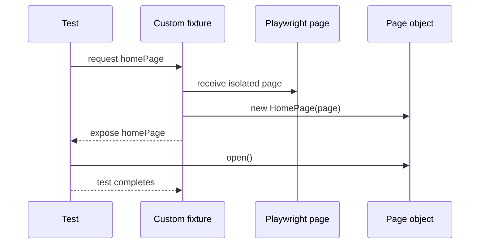

# Fixtures: setup and dependency injection

Playwright's built-in `page` fixture creates an isolated browser context and page per test. `base.fixture.js` composes page objects on top of that same page, so tests receive initialized collaborators.



Fixtures are set up when requested, can depend on other fixtures, and are torn down after the test lifecycle. A fixture manages construction/lifecycle; a page object owns page behavior; the test owns the business assertion.

Example:

```js
import { test, expect } from '../../fixtures/base.fixture.js';

test('home page renders', async ({ homePage }) => {
  await homePage.open();
  await expect(homePage.heroCarousel).toBeVisible();
});
```

No shared authenticated state is configured. Account-based tests should provision unique credentials and delete only accounts they created. Never commit secrets or browser storage state.
